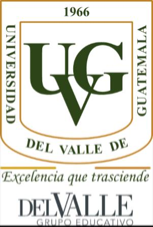
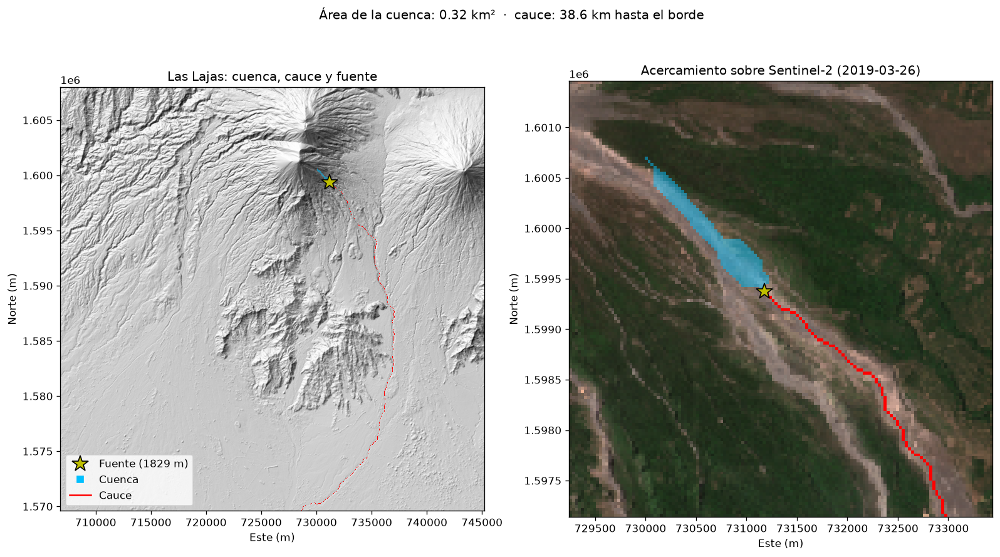
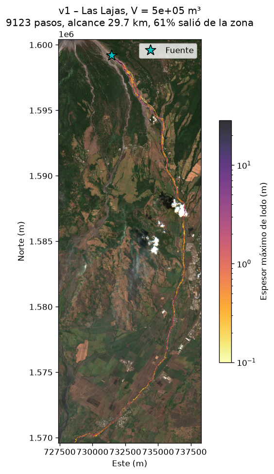
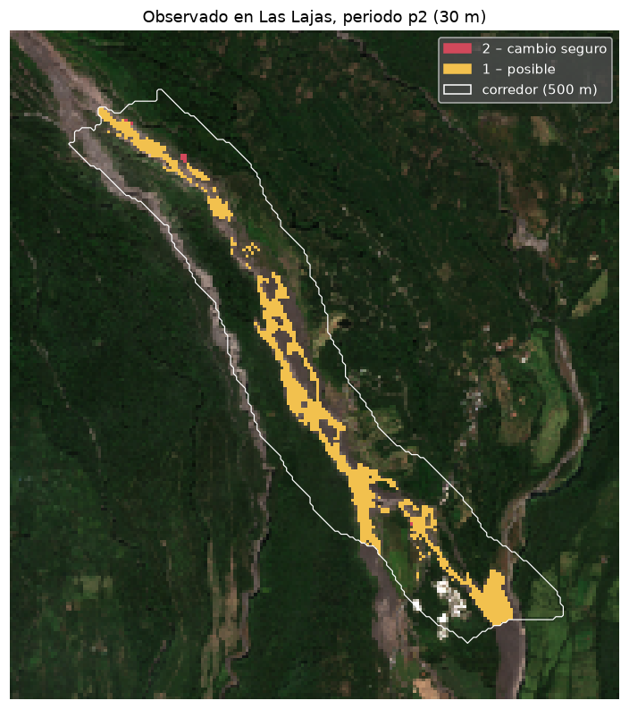
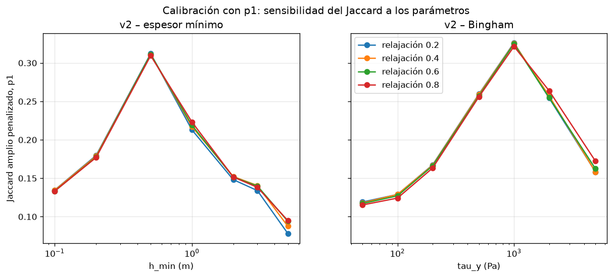
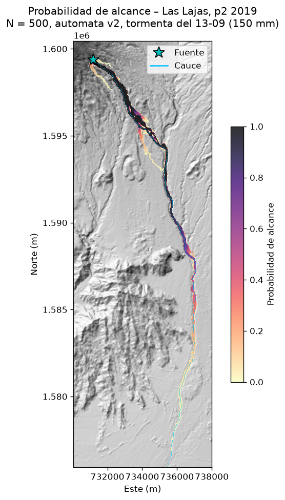
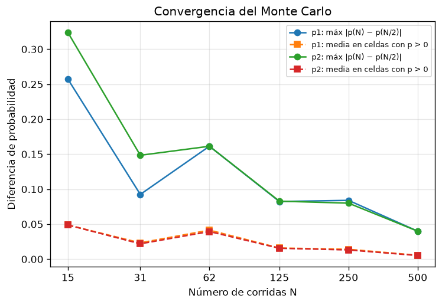
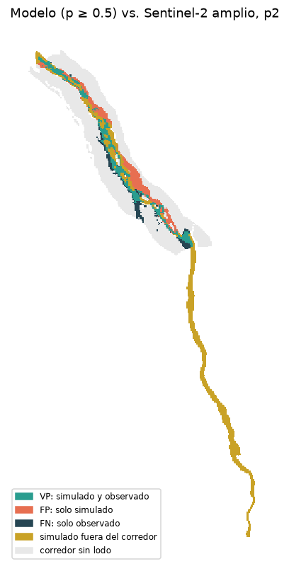
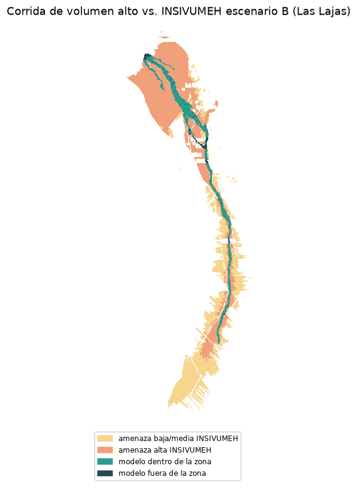

UNIVERSIDAD DEL VALLE DE GUATEMALA

CC2017 — Modelación y Simulación

Sección 10 · Ing. Luis Suriano

Proyecto final

Simulación probabilística de lahares en la barranca Las Lajas, Volcán de Fuego

Leonardo Dufrey Mejía Mejía – 23648

María José Girón Isidro – 23559

Isabella Obando – 23074

Anthony Lou – 23410

Repositorio de GitHub: <a href="https://github.com/anthonylouschwank/Proyecto-Modelacion">https://github.com/anthonylouschwank/Proyecto-Modelacion</a>

Guatemala, 3 de noviembre de 2026

# 1. Descripción del problema

Un lahar es un flujo de lodo volcánico: agua de lluvia mezclada con ceniza, arena y
bloques que baja por las barrancas de un volcán con una consistencia parecida al concreto
fresco. No necesita una erupción: basta con lluvia fuerte sobre material suelto. En el
Volcán de Fuego hay lahares casi cada época de lluvia, y en la barranca Las Lajas han
dañado varias veces el puente de la RN-14 y amenazado a El Rodeo y La Reina.

No hay que confundirlo con el flujo piroclástico del 3 de junio de 2018 (gas caliente
y ceniza durante la erupción), que sepultó San Miguel Los Lotes. Ese evento importa aquí
por otra razón: dejó la barranca Las Lajas sin vegetación y llena de material suelto, la
fuente de los lahares de los años siguientes.

Pregunta del proyecto: si con la lluvia observada en un periodo se genera un lahar
en Las Lajas, ¿qué zonas alcanza y con qué probabilidad?

# 2. Análisis

- Es un problema espacial y con incertidumbre. El alcance depende del terreno real,
  del volumen de lodo y de la "resistencia" del lodo, y ninguno de los dos últimos se
  conoce con precisión. Una sola simulación daría una falsa certeza: lo útil para gestión
  de riesgo es un mapa de probabilidad.
- Datos disponibles y sus límites.
  - Terreno: Copernicus DEM GLO-30 (30 m), un modelo de superficie (incluye árboles y
    casas) de antes de 2018.
  - Lluvia: Open-Meteo (modelo ECMWF IFS, celda de ~9 km) en el cráter, horaria.
  - "Verdad": imágenes Sentinel-2 L2A (10 m) casi sin nubes del 2019-03-26, 2019-07-04 y
    2019-12-11; boletines de CONRED e INSIVUMEH; mapa de amenaza de lahares del INSIVUMEH
    (2018, escenario B).
- Calibración y prueba separadas. La temporada 2019 se parte en dos periodos entre
  las tres imágenes: p1 (26 mar – 4 jul) para calibrar y p2 (4 jul – 11 dic)
  para probar sin volver a ajustar.

# 3. Propuesta de solución

Combinar tres técnicas del curso:

1. Autómata celular sobre el DEM real que mueve el lodo celda por celda.
2. Modelo de entrada que convierte la lluvia de cada tormenta en volumen de lodo.
3. Simulación Monte Carlo sobre los parámetros inciertos para obtener la probabilidad
   de alcance de cada celda.

Y validar el resultado contra fuentes independientes: Sentinel-2 (con métricas de
traslape), puntos clave con desenlace conocido y el mapa de amenaza oficial.

# 4. Descripción de la solución

El código está en `src/` y se corre en el orden del README ("Correr todo el pipeline").

## 4.1 Cuenca, cauce y volumen (`src/inputs/`)

- `cuenca.py` (pysheds): rellena el DEM, calcula dirección de flujo D8 y acumulación,
  ubica la fuente del lahar sobre Las Lajas a 1829 m (celda (287, 812)) y traza el
  cauce hasta el borde de la zona con su distancia acumulada. Detecta la
  confluencia con el río Guacalate en el km 7.44, donde el área drenada salta de
  11.3 km² a 124 km².
- `volumen.py`: separa la serie horaria en tormentas (≥ 20 mm, separadas por ≥ 6 h secas)
  y calcula el volumen con un balance simple:

  $$V_{agua} = P \cdot A \cdot C, \qquad V_{lahar} = \frac{V_{agua}}{1 - C_s}$$

  con `A` = 11.3 km² (Las Lajas hasta la confluencia), `C` el coeficiente de
  escurrimiento y `Cs` la concentración de sedimento.

## 4.2 Autómata celular (`src/modelo/automata.py`)

Algoritmo de minimización de diferencias (Di Gregorio y Serra, 1999), base de los
modelos SCIDDICA de flujos de detritos. Cada celda tiene terreno `z` y espesor de lodo
`h`; con superficie libre $H = z + h$ y vecindad de Moore:

1. Lodo que puede moverse: $h_{mov} = h$ en v1 y $h_{mov} = \max(0,\, h - h_{crit})$ en v2,
   con espesor crítico de Bingham
   $$h_{crit} = \max\!\left(h_{min},\; \frac{\tau_y}{\rho\, g \sin\theta}\right)$$
   donde $\theta$ es la pendiente de la superficie libre hacia el vecino más bajo. En
   pendiente fuerte $h_{crit}$ es pequeño (el lodo fluye); en la planicie es enorme (se detiene).
2. Sale $\text{relajación} \cdot \min(h_{mov}, (H_i - \min_j H_j)/2)$, repartido entre los
   vecinos más bajos en proporción a $(H_i - H_j)/d_{ij}$.
3. El volumen se suelta en la fuente durante 100 pasos; el lodo que sale de la zona se
   contabiliza; la simulación termina cuando lo que se mueve en un paso es menor que
   $10^{-4}$ del volumen.

Se compila con Numba y solo recorre el rectángulo con lodo: una corrida tarda de menos de
un segundo a unos 10 s. `tests/test_automata.py` verifica conservación de masa (error
< 10⁻⁹), plano inclinado, cuenco, canal en V, borde absorbente, que v2 se detiene en
plano, y que más volumen ⇒ más alcance y más resistencia ⇒ menos alcance (13 pruebas).

## 4.3 Proceso iterativo del modelo

El registro completo, con figuras y tablas, está en `results/modelo/registro_iteraciones.md`.

| Versión | Cambio | Qué pasó | Qué motivó |
|---|---|---|---|
| v1.0 | Lodo sin resistencia, fuente a ojo | Se fue por la barranca del oeste | La fuente estaba al otro lado de una divisoria: se ajustó con el DEM |
| v1.2 | Fuente corregida, volumen en 100 pasos | Recorre 29.7 km y 61 % sale de la zona: se comporta como agua | Agregar resistencia (v2) |
| v2.0 | Espesor crítico (`h_min` / Bingham) | Hasta v1 se detenía a 2.5 km, atrapada en hoyos del DSM | Quitar el ruido del terreno |
| v2.1 | DEM sin hoyos | v1 llega al mar; v2 sí controla el alcance | Calibrar |
| v2.2 | Primera calibración | Ganaba la resistencia más baja y v1 le ganaba a v2 | Revisar el volumen y el dominio de validación |
| v2.3 | Volumen con el área de toda la barranca; validar solo en Las Lajas; objetivo penalizado | — | Calibración final |
| v2.4 | Calibración final | Bingham, $\tau_y$ = 1000 Pa | Usar en el Monte Carlo (v3) |
| v3 | Monte Carlo con v2 calibrada | Mapas de probabilidad p1 y p2 | — |

{width=55%}

## 4.4 Mapa observado con Sentinel-2 (`src/sentinel/ndvi.py`)

Para cada periodo se compara el NDVI de la imagen inicial y la final dentro de un
corredor de 500 m alrededor del cauce de Las Lajas (hasta la confluencia):

| Clase | Significado | Regla |
|---|---|---|
| 2 | Cambio seguro: había vegetación y ya no | NDVI antes ≥ 0.4 y ΔNDVI ≥ 0.25 |
| 1 | Posible: desnudo al final, pero ya lo estaba | NDVI después < 0.2 |
| 0 | Vegetación | resto |
| 255 | Sin dato (nubes, sombras, fuera del corredor) | máscara SCL |

Se quitan manchas de menos de 5 píxeles y las que no tocan el cauce, y se pasa a la
cuadrícula de 30 m por mayoría. El corredor llegó a esa forma en cuatro iteraciones
(`results/sentinel/umbrales.md`): con el corredor de 38 km aparecían parcelas de caña
cosechadas como "cambio seguro"; la solución fue validar solo en Las Lajas.

Hallazgo: dentro de Las Lajas casi no hay cambio seguro en 2019 (≈ 0 km² en p1 y
0.01 km² en p2) y sí ~1 km² de cauce desnudo. La barranca ya estaba pelada desde 2018:
los lahares de 2019 pasan por un cauce sin vegetación que perder. Por eso la métrica
principal es la versión amplia (clases 1 y 2).

{width=50%}

## 4.5 Calibración (`src/modelo/calibrar.py`)

Búsqueda en cuadrícula de `relajacion` (0.2–0.8) × `h_min` (0.1–5 m) y × $\tau_y$
(50–5000 Pa) con la tormenta mayor de p1 (61 mm, 6.3 × 10⁵ m³). Objetivo: Jaccard
amplio penalizado,

$$J_{pen} = \frac{|S \cap O|}{|S \cup O| + |S_{fuera}|}$$

que además del traslape cuenta como error el lodo simulado fuera del corredor (si no,
siempre gana el modelo que llega más lejos). Resultado (`results/modelo/calibracion_p1.png`):
máximo claro en $\tau_y$ = 1000 Pa ($J_{pen}$ = 0.326) y en $h_{min}$ = 0.5 m (0.312); la
relajación casi no influye. 1000 Pa está dentro de los esfuerzos de fluencia reportados
para flujos de detritos (10²–10⁴ Pa; Major y Pierson, 1992).

## 4.6 Monte Carlo (`src/montecarlo/correr.py`)

Cada corrida sortea, con distribución uniforme:

| Parámetro | Rango | Justificación (detalle en `src/montecarlo/rangos.py`) |
|---|---|---|
| `C` | 0.3 – 0.7 | La ceniza fresca sella el suelo (Jones et al., 2017; Pierson y Major, 2014) |
| `Cs` | 0.3 – 0.6 | Flujos hiperconcentrados a de detritos (Pierson y Costa, 1987; Pierson, 2005) |
| `factor_lluvia` | 1.0 – 1.5 | El modelo de 9 km suaviza los picos de tormentas convectivas |
| `relajacion` | 0.14 – 0.26 | ± 30 % de lo calibrado |
| $\tau_y$ | 700 – 1300 Pa | ± 30 % de lo calibrado |

Toma la tormenta mayor del periodo, calcula su volumen, corre la v2 y suma las celdas
alcanzadas: $P(\text{alcance}) = \text{corridas con lodo} / N$, con N = 500 y semilla fija.
Suposición: con la misma fuente y parámetros, un volumen mayor cubre lo que cubre uno
menor, así que la huella de la temporada ≈ la de la tormenta mayor.

## 4.7 Validación (`src/validacion/`)

- `metricas.py`: Jaccard, matriz de confusión (precisión, sensibilidad, F1), error de
  alcance por el cauce, fracción fuera del corredor, Jaccard penalizado y puntos clave.
  Probadas con círculos inventados (`tests/test_metricas.py`).
- `mapa_amenaza.py`: clasifica el mapa del INSIVUMEH por color (HSV) en amenaza alta,
  media y baja, quita texto y carreteras con apertura morfológica y lo pasa a 30 m.
- `data/puntos_clave.csv`: puente Las Lajas (RN-14), San Miguel Los Lotes, El Rodeo,
  La Reina, puente Guacalate (CA-2) y dos puntos de control en otra barranca
  (coordenadas de OpenStreetMap).
- `data/catalogo_lahares.csv`: cuatro lahares de Las Lajas en 2019 con fuente (CONRED,
  INSIVUMEH, prensa): 11 abr y 10 may (p1), 4 y 28 oct (p2).
- `evaluar.py`: prueba final con los parámetros ya fijos.

# 5. Herramientas aplicadas

| Herramienta | Para qué | ¿Vista en clase? |
|---|---|---|
| Autómatas celulares | Modelo de flujo del lodo | Sí |
| Simulación Monte Carlo | Propagar la incertidumbre de 5 parámetros | Sí |
| Análisis de convergencia | Saber si N = 500 basta | Sí |
| Python, NumPy, pandas, Matplotlib | Todo el pipeline | Sí |
| Numba | Compilar el paso del autómata | No (ver abajo) |
| rasterio / GDAL | Leer y escribir rasters georreferenciados, reproyectar | No (ver abajo) |
| pysheds | Dirección de flujo, acumulación y cuencas | No (ver abajo) |
| NDVI con Sentinel-2 | Detectar pérdida de vegetación | No (ver abajo) |
| STAC (pystac-client) | Buscar y leer imágenes satelitales en la nube | No (ver abajo) |
| pytest | 27 pruebas automáticas | — |

Numba traduce funciones de Python con ciclos a código máquina (compilación JIT). El
paso del autómata recorre ~10⁵ celdas por paso y miles de pasos; en Python puro tardaría
horas por corrida, con Numba entre menos de 1 s y ~10 s.

rasterio / GDAL: un raster georreferenciado es una matriz más una transformación
afín que dice qué coordenada (UTM 15N) corresponde a cada celda. Todo el proyecto usa la
misma cuadrícula de 1280 × 1280 celdas de 30 m, así que las máscaras se combinan
directamente con NumPy.

pysheds implementa el algoritmo D8: cada celda drena hacia su vecina de mayor
pendiente descendente; la acumulación cuenta cuántas celdas drenan a través de cada una.
Con eso se obtiene la cuenca de un punto, el cauce y la confluencia.

NDVI = (NIR − Rojo) / (NIR + Rojo): la vegetación refleja mucho infrarrojo cercano
y absorbe el rojo, así que vale ~0.85 en vegetación y ~0.05 en suelo o lodo.

STAC es un estándar de catálogos de imágenes satelitales; con él se leen solo los
píxeles de la zona de estudio de las imágenes Sentinel-2 en AWS, sin bajar escenas completas.

## 5.1 Reproducibilidad

Todo el proyecto se regenera desde cero con los scripts del repositorio, en este orden
(cada paso usa lo que produce el anterior):

| Paso | Comando | Produce |
|---|---|---|
| 1 | `python -m src.inputs.cuenca` | Fuente, cuenca, cauce y confluencia |
| 2 | `python -m src.inputs.volumen` | Tormentas de 2019 y su volumen |
| 3 | `python -m src.sentinel.ndvi` | Mapas observados de p1 y p2 |
| 4 | `python -m src.validacion.mapa_amenaza` | Mapa del INSIVUMEH clasificado |
| 5 | `python -m src.modelo.calibrar` | Calibración de v2 y comparación v1 contra v2 |
| 6 | `python -m src.montecarlo.correr --n 500` | Mapas de probabilidad de p1 y p2 |
| 7 | `python -m src.validacion.evaluar` | Prueba final, puntos clave e INSIVUMEH |

Las descargas (DEM, lluvia e imágenes Sentinel-2) no se suben al repositorio porque
pesan varios cientos de MB; los scripts de `src/` las vuelven a bajar. Las 27 pruebas
automáticas se corren con `python -m pytest`. El Monte Carlo completo, 500 corridas por
periodo con 12 procesos, tarda unos 10 minutos en una laptop.

# 6. Resultados

Todos los números se regeneran con los comandos del README; las tablas están en
`results/modelo/`, `results/montecarlo/` y `results/validacion/`.

## 6.1 v1 contra v2 (proceso iterativo)

Una corrida con el volumen central de la tormenta mayor de cada periodo
(`results/modelo/metricas_versiones.csv`):

| Versión | Periodo | Volumen | Alcance por el cauce | Jaccard penalizado | Jaccard amplio | Fuera del corredor |
|---|---|---|---|---|---|---|
| v1 | p1 (calibración) | 6.3 × 10⁵ m³ | 38.6 km (sale de la zona) | 0.124 | 0.409 | 80 % |
| v2 | p1 (calibración) | 6.3 × 10⁵ m³ | 8.3 km | 0.326 | 0.456 | 38 % |
| v1 | p2 (prueba) | 1.5 × 10⁶ m³ | 38.6 km (sale de la zona) | 0.114 | 0.451 | 80 % |
| v2 | p2 (prueba) | 1.5 × 10⁶ m³ | 14.1 km | 0.227 | 0.437 | 54 % |

La resistencia de Bingham hace que el lodo se detenga en la planicie en vez de seguir
hasta el mar. En el periodo de prueba, que no se usó para calibrar, el Jaccard
penalizado de v2 duplica al de v1.

## 6.2 Monte Carlo (v3)

| | p1 | p2 |
|---|---|---|
| Tormenta mayor | 61 mm (12 jun) | 150 mm (13 sep) |
| Volumen sorteado | 3.4 × 10⁵ – 1.7 × 10⁶ m³ | 8.3 × 10⁵ – 4.1 × 10⁶ m³ |
| Área con P > 0 | 3.14 km² | 6.17 km² |
| Área con P ≥ 0.5 | 1.62 km² | 3.12 km² |
| Alcance mediano por el cauce | 9.4 km | 16.6 km |

Convergencia (`results/montecarlo/convergencia.png`): la diferencia máxima entre el
mapa con N y con N/2 corridas baja de 0.26–0.32 (N = 15) a 0.04 (N = 500), y la
diferencia media en las celdas con lodo a 0.006. N = 500 es suficiente.

{width=55%}

{width=70%}

Los mapas de probabilidad (`prob_p1.png`, `prob_p2.png`) muestran P ≈ 1 en la parte alta
de Las Lajas hasta el puente de la RN-14 y una cola de probabilidad baja que sigue por el
Guacalate.

## 6.3 Prueba contra Sentinel-2

Mapa del Monte Carlo con umbral P ≥ 0.5 contra la máscara observada
(`results/validacion/tabla_metricas.csv`):

| Periodo | Versión | Celdas observadas | Jaccard | Jaccard penalizado | F1 | Precisión | Sensibilidad |
|---|---|---|---|---|---|---|---|
| p1 (calibración) | amplia | 1158 | 0.464 | 0.311 | 0.634 | 0.665 | 0.605 |
| p2 (prueba) | amplia | 1107 | 0.436 | 0.209 | 0.607 | 0.528 | 0.713 |
| p1 / p2 | estricta | 1 / 8 | — | — | — | — | — |

- En la prueba (p2) el modelo acierta el 71 % del cauce desnudo observado
  (sensibilidad) y el 53 % de lo que simula dentro del corredor está observado.
- El desempeño en p2 es parecido al de p1 (F1 0.61 contra 0.63): no hay
  sobreajuste a los datos de calibración.
- La versión estricta no se puede evaluar: casi no hay "cambio seguro" en Las Lajas.
- El 41 % (p1) y el 57 % (p2) del área simulada cae fuera del corredor, casi todo
  pasando la confluencia, por el Guacalate (`sim_vs_obs_p2.png`). Ahí no hay "verdad"
  confiable, así que no sabemos si es error: los lahares grandes de Fuego sí llegan al
  Guacalate. Por el mismo motivo el error de alcance (+2.0 km en p1, +9.2 km en p2) está
  inflado: la observación se cortó en el km 7.44.

{width=50%}

## 6.4 Puntos clave

`results/validacion/puntos_clave.csv`:

| Punto | P (p1) | P (p2) | Esperado | Resultado |
|---|---|---|---|---|
| Puente Las Lajas (RN-14) | 0.98 | 1.00 | sin dato de 2019 | alcanzado |
| San Miguel Los Lotes | 0.00 | 0.01 | no | acierto |
| El Rodeo | 0.00 | 0.00 | no | acierto |
| La Reina | 0.00 | 0.00 | no | acierto |
| Puente Guacalate (CA-2) | 0.00 | 0.03 | sin dato | no alcanzado |
| La Trinidad (control) | 0.00 | 0.00 | no | acierto |
| Finca El Zapote (control) | 0.00 | 0.00 | no | acierto |

Cero falsas alarmas en las comunidades y los puntos de control. El modelo predice
con P ≈ 1 que los lahares de 2019 llegaron al puente de la RN-14, algo que ha pasado
otras veces, pero los boletines de 2019 no lo confirman ni lo descartan.

## 6.5 Mapa de amenaza del INSIVUMEH (escenario B)

Corrida de volumen alto (tormenta máxima de 2019 × 1.5, C = 0.7, Cs = 0.6 → 4.4 × 10⁶ m³)
contra la zona de amenaza de Las Lajas (`insivumeh_vs_modelo.png`):

- El 90 % del área simulada cae dentro de la zona de amenaza oficial: el modelo no
  manda lodo a donde el INSIVUMEH dice que no llega.
- La simulación cubre solo el 12 % de la zona (20 % de la zona de amenaza alta).
  La zona del INSIVUMEH incluye todo el abanico del depósito piroclástico de 2018 cerca
  del cono y bordes anchos de tipo LAHARZ en la planicie; nuestro autómata a 30 m
  concentra el lodo en el cauce. El alcance (24 km) llega cerca del cruce con la CA-2,
  como el mapa.

{width=50%}

# 7. Conclusiones

1. Un autómata celular con resistencia de Bingham sobre el terreno real reproduce
   el comportamiento básico de un lahar: corre por la barranca y se detiene al llegar a
   la planicie. La versión sin resistencia (v1) se comporta como agua y llega al mar.
2. La calibración con p1 dio $\tau_y$ = 1000 Pa, un valor físicamente razonable para
   flujos de detritos. En la prueba con p2, sin reajustar, el modelo mantuvo su
   desempeño (F1 0.61 contra 0.63), duplicó a v1 en Jaccard penalizado y no dio
   ninguna falsa alarma en comunidades ni puntos de control.
3. El Monte Carlo convierte la incertidumbre de la lluvia, el volumen y la reología
   en un mapa de probabilidad que converge con 500 corridas. El puente de la RN-14 queda
   con P ≈ 1 en ambos periodos de 2019.
4. La mayor parte del trabajo no fue el modelo sino decidir contra qué compararlo.
   Tres errores de planteamiento (hoyos del DSM, el río Guacalate dentro del corredor,
   un volumen calculado con una cuenca demasiado chica) solo aparecieron al revisar si
   los resultados tenían sentido físico, y cada uno cambió la conclusión.
5. Sentinel-2 no ve los lahares de 2019 en Las Lajas: la barranca ya estaba pelada
   desde 2018. Para validar mejor haría falta una "verdad" distinta: alcances
   reportados por evento, sensores sísmicos o modelos de elevación repetidos con dron.

Trabajo futuro: fuentes múltiples a lo largo de la barranca, erosión y crecimiento
del volumen en el camino, otras barrancas (Ceniza, Seca) y un DEM posterior a 2018.

# 8. Limitaciones

- Volumen: el balance P·A·C/(1−Cs) ignora la infiltración variable, la erosión del
  cauce (el lahar crece en el camino) y cuánto sedimento suelto hay realmente.
- Lluvia: una sola celda de 9 km para todo el cono; subestima tormentas convectivas.
- Terreno: DSM de antes de 2018 (no refleja el relleno de las barrancas) y con hoyos
  rellenados artificialmente.
- Fuente fija: en la realidad los lahares se forman en varios puntos de la barranca.
- Tormenta mayor = huella de la temporada: suposición para ahorrar cómputo.
- "Verdad" débil: Sentinel-2 muestra la temporada acumulada; en Las Lajas el cauce
  ya estaba desnudo, así que la versión amplia dice por dónde puede pasar el lodo, no
  hasta dónde llegó. Los boletines son cualitativos y no dicen el alcance.
- Una sola barranca y dos periodos: pocos datos de prueba.
- Relajación: parámetro numérico casi sin efecto en el resultado.

# 9. Bibliografía

- Di Gregorio, S. y Serra, R. (1999). An empirical method for modelling and simulating
  some complex macroscopic phenomena by cellular automata. *Future Generation Computer
  Systems*, 16(2–3), 259–271.
- Iverson, R. M., Schilling, S. P. y Vallance, J. W. (1998). Objective delineation of
  lahar-inundation hazard zones. *GSA Bulletin*, 110(8), 972–984.
- Jones, R., Thomas, R. E., Peakall, J. y Manville, V. (2017). Rainfall-runoff properties
  of tephra: simulated effects of grain-size and antecedent rainfall. *Geomorphology*,
  282, 39–51. doi:10.1016/j.geomorph.2016.12.023
- Major, J. J. y Pierson, T. C. (1992). Debris flow rheology: experimental analysis of
  fine-grained slurries. *Water Resources Research*, 28(3), 841–857. doi:10.1029/91WR02834
- Pierson, T. C. y Costa, J. E. (1987). A rheologic classification of subaerial
  sediment-water flows. *Reviews in Engineering Geology*, 7, 1–12.
- Pierson, T. C. (2005). Hyperconcentrated flow – transitional process between water
  flow and debris flow. En Jakob, M. y Hungr, O. (eds.), *Debris-flow Hazards and
  Related Phenomena*, 159–202. Springer.
- Pierson, T. C. y Major, J. J. (2014). Hydrogeomorphic effects of explosive volcanic
  eruptions on drainage basins. *Annual Review of Earth and Planetary Sciences*, 42, 469–507.
- Vallance, J. W. e Iverson, R. M. (2015). Lahars and their deposits. En Sigurdsson, H.
  et al. (eds.), *The Encyclopedia of Volcanoes*, 2.ª ed., 649–664. Academic Press.
- Buondonno, C. (2020). *Rain generated lahars prior to the 2018 catastrophic eruption
  of Fuego volcano, Guatemala*. Tesis de maestría, Michigan Technological University.
- Copernicus DEM GLO-30 (ESA). Copernicus Sentinel-2 L2A, vía Earth Search (Element84).
- Open-Meteo Historical Weather API. <https://open-meteo.com>
- INSIVUMEH (2018). Mapa preliminar de amenaza de lahares, crisis eruptiva del Volcán de
  Fuego, escenario B. INSIVUMEH, boletín BEFGO #77-2019.
- CONRED, boletín informativo 112-2019. <https://conred.gob.gt>
- Emisoras Unidas (11-05-2019) y Soy502 (28-10-2019), notas sobre lahares en Las Lajas.
